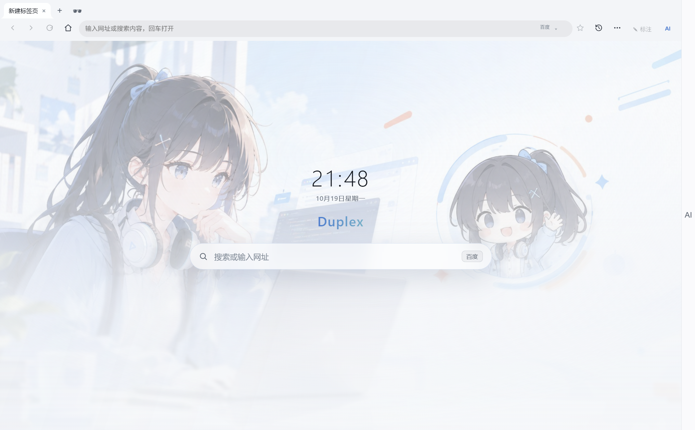
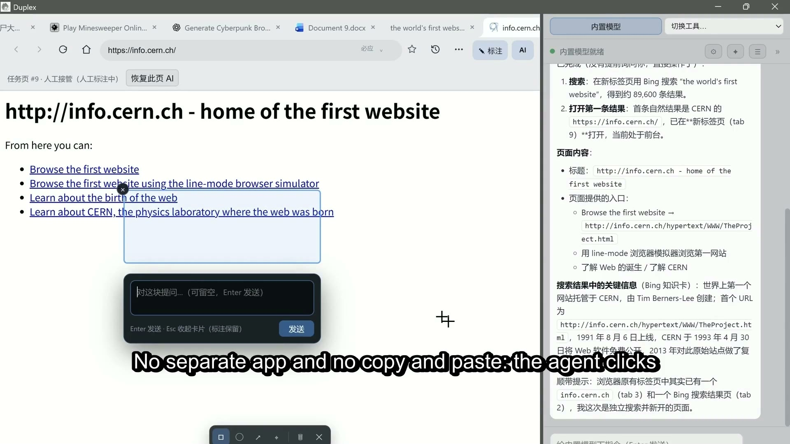
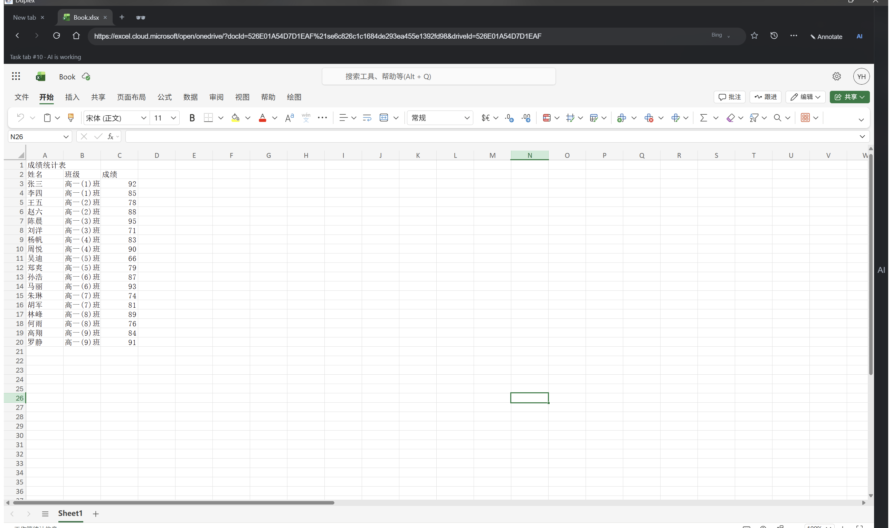
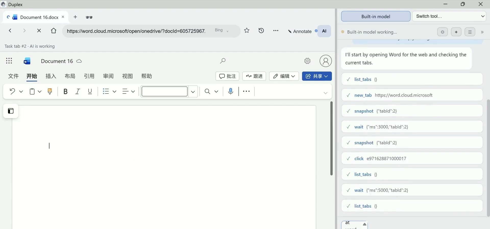
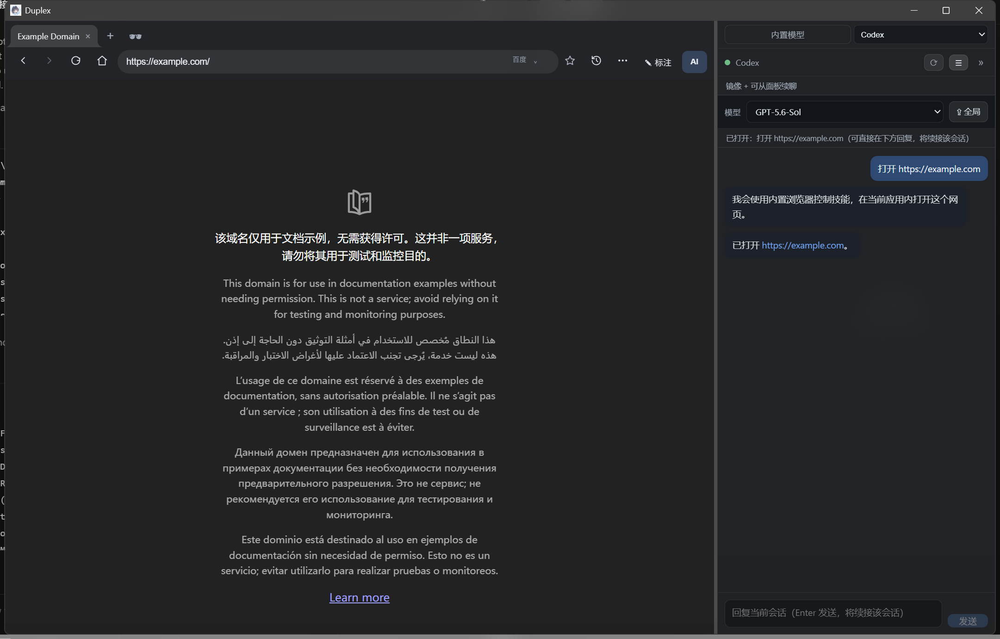
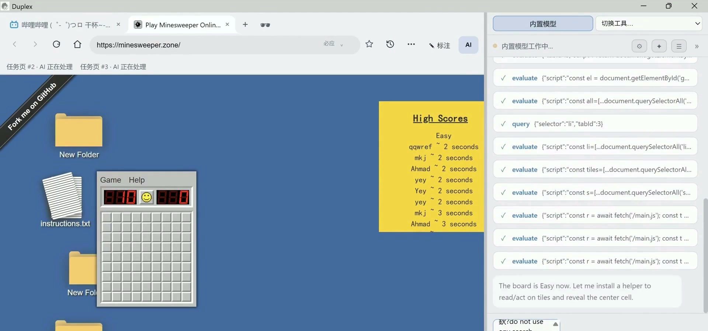
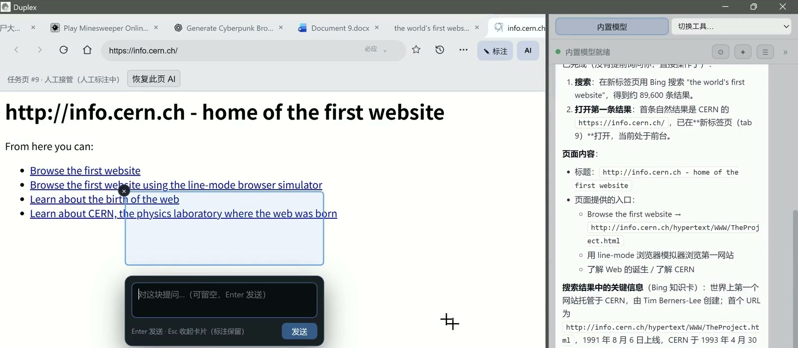
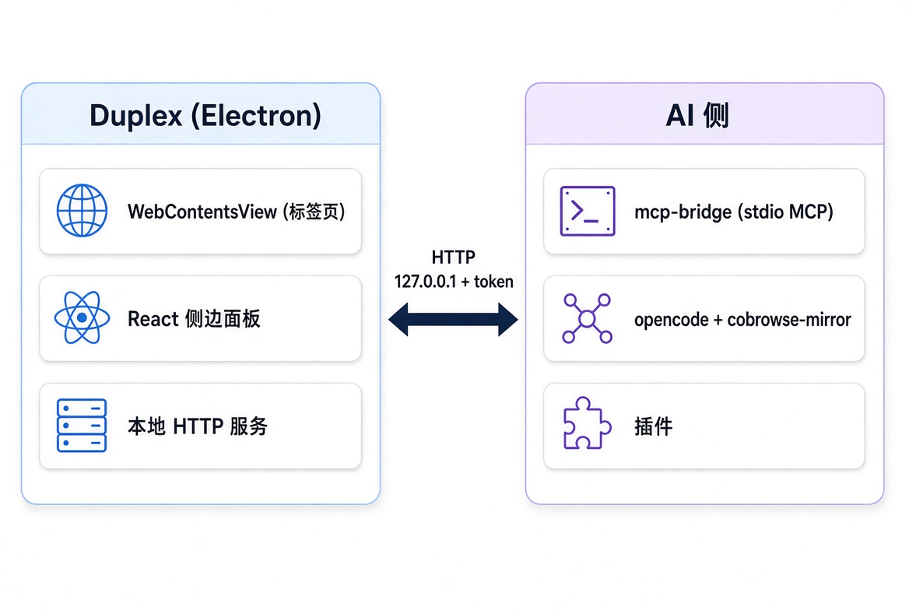

# Duplex

[](https://github.com/Eric-huang799/duplex/actions/workflows/build.yml)
[](https://glama.ai/mcp/servers/Eric-huang799/duplex)
[](https://github.com/punkpeye/awesome-mcp-servers)
[](https://github.com/MobinX/awesome-mcp-list)
[](https://github.com/TensorBlock/awesome-mcp-servers)
[](https://github.com/yzfly/Awesome-MCP-ZH)
[](https://freemcp.space/featured/duplex)

> **Listed in** [awesome-mcp-servers](https://github.com/punkpeye/awesome-mcp-servers) · [awesome-mcp-list](https://github.com/MobinX/awesome-mcp-list) · [TensorBlock](https://github.com/TensorBlock/awesome-mcp-servers) · [Awesome-MCP-ZH](https://github.com/yzfly/Awesome-MCP-ZH) · [freemcp.space](https://freemcp.space/featured/duplex) · [Glama](https://glama.ai/mcp/servers/Eric-huang799/duplex)

<p align="center"></p>

> **One browser shared by a human and an AI.** You see the rendered page; the AI reads the DOM, source and screenshots and can act through browser tools. Same tabs, same live session, at the same time.

**English** | [中文](README.zh-CN.md)



*Duplex start page (light theme). A [dark theme](docs/screenshots/start-page-dark.png) is also included.*

## Demo

**Full demo — 2 min, with captions and music:**

[](docs/videos/duplex-demo.mp4)

*One continuous walkthrough: the AI opens the first website ever published, plays a Bilibili video, clears a Minesweeper board, writes a sentence in Microsoft Word for the web, and shows bookmarks already on the PC — while the side panel mirrors every decision and the browser stays visible.*



*A harder, unscripted test: with no spreadsheet-specific skill installed, the built-in model used the stock API and a few simple automation skills to push a whole grade sheet into Excel for the web. It worked, but it was slow and token-heavy — a feasibility demo, not a recommended workflow. The screenshot shows the resulting sheet in the current UI.*

## 0.2.10: the panel-scoped agent release

0.2.10 makes the boundary between an AI and your browser explicit: **an agent gets browser control only when you start or continue it from Duplex.** Nothing is installed globally behind your back.

- **Bilingual interface** — the renderer, native menus, context menus, dialogs and the annotation overlay switch between Simplified Chinese and English. Follow the system locale or pin a language from the tools menu.
- **In-app search-engine menu** — the address-bar engine picker is a themed in-app dropdown for Baidu, Bing and Google; it no longer depends on a native popup menu.
- **Panel-scoped browser control** — Codex, Claude Code and opencode receive Duplex's MCP browser tools only for prompts issued from the panel. Standalone sessions do not get browser control. opencode gets a dedicated `duplex` agent; normal opencode sessions deny `duplex_*` by default.

| Agent | Conversation in the panel | Browser control from the panel | Continue from the panel |
|---|---|---|---|
| **Built-in model** | Live stream | Built-in browser tools | Session history |
| **opencode** | Live text + tool calls | `duplex` agent, `duplex_*` allowed | Panel message or plugin |
| **Codex** | Local transcript | MCP injected for each panel launch/resume | `codex exec resume` |
| **Claude Code** | Local transcript | MCP via `--mcp-config` for each panel launch/resume | `claude --resume` |
| **Gemini / Qwen / custom** | Transcript / stream | Depends on the CLI's own tools | CLI-specific |

## Why Duplex

Most AI browsing tools fall into one of two camps:

- **Separate automation instances** run a hidden browser. You cannot see the page, use the same login session, or take over a step when the AI is about to do something wrong.
- **Chat assistants beside the browser** can discuss a page but cannot reliably act inside the page you are already using.

Duplex is a real desktop browser built for both of you. The AI works in the same tabs and the same logged-in session you see; every action is visible on the page; and when you touch the page, the AI yields instead of fighting you for input.

It is not a browser wrapper around a remote agent. It is the browser.

## Highlights

- **A real browser** — tabs, address bar with search (Baidu / Bing / Google), back / forward / reload, loading state, themes, a wallpaper start page, customizable keyboard shortcuts, a full bookmark manager and session restore.
- **Human-first collaboration** — each AI task is bound to its tab. While you scroll, type or focus something, the AI keeps reading but pauses its own modifications on that page. A status bar lists human-controlled pages and hands each one back with a click.
- **24 browser tools** — `snapshot` turns a page into a compact DOM outline with `[eN]` refs; clicks, typing, drags and reads run through Playwright locators over the browser's own Chromium, with iframe and open-shadow support and cancellable waits. The bridge also exposes six skill/file tools for the built-in agent.
- **Panel-scoped agent control** — Codex and Claude Code get an MCP server only for a panel-driven launch or resume; opencode gets a dedicated `duplex` agent. Standalone agents do not get browser control and do not open Duplex on their own.
- **Built-in agent** — connect any OpenAI-compatible provider (DeepSeek, Kimi, Qwen, GLM, Ollama, …), import providers from opencode, and let the browser drive itself with tools and skills.
- **Visible actions** — a cursor ring, element highlight and status bar show what the AI is doing; page annotations let you draw a box, circle, arrow or point and attach a question.
- **Emergency stop** — press `F2` or `Ctrl+Shift+K` (configurable) at any moment. Running tool calls are aborted, CLI children are terminated, pending confirmations are denied and queued messages are dropped. The pause survives a restart.
- **Local-first** — settings, history, bookmarks, tabs and session data live on your machine. Prompts go only to the model provider or CLI you configured.

## Feature tour

### Built-in agent in action



*The built-in model works through a real Word for the web session; every tool call appears as a card while the page stays visible.*

### External agents in the same panel



*Codex and Claude Code sessions are mirrored in the same panel. Start or resume them from the tool selector; panel messages continue the same thread.*

### Visible AI actions



*Every AI action is drawn on the page — cursor, element highlight and status bar. Press F2 to take over.*

### Page annotations



*Draw a box, circle, arrow or point and attach a question; Duplex turns it into a structured brief for the AI.*

## Quick start

### Installer (Windows / macOS / Linux)

1. Download the latest installer from [Releases](../../releases): `Duplex Setup x.y.z.exe` (Windows), `.dmg` (macOS, Apple Silicon / Intel) or `.AppImage` (Linux).
2. Run it and launch Duplex.

### Build from source

```bash
npm install
npm run build          # Electron app -> out/
npm run build:bridge   # stdio MCP bridge -> dist-bridge/index.cjs
```

> If Electron's binary download fails (e.g. behind a slow mirror), retry with:
> `$env:ELECTRON_MIRROR="https://npmmirror.com/mirrors/electron/"; node node_modules/electron/install.js`

Run it:

```bash
npm run dev    # development mode with HMR
# or
npm start      # preview the production build
```

> Running a dev build next to the installed app? Set `DUPLEX_DATA_DIR` to another directory so the two do not share settings or the local endpoint.

### First run

1. Open the AI panel with the **AI** button in the toolbar.
2. Pick **Built-in model** and add an OpenAI-compatible provider, or pick an external CLI from the tool selector.
3. Ask for something visible: *"Open Hacker News and summarize the top three stories."*

## Connect your agents

The important rule in 0.2.10: **standalone agent sessions do not get Duplex's browser tools.** The tools are injected for a single panel-driven launch or resume. This keeps the default safe: an agent working in a terminal will not silently open a browser or take over your session.

### Built-in model

Panel → **Built-in model** → **Model settings**. Add an OpenAI-compatible provider (base URL, API key, model name), or click **Import from opencode** to reuse an existing provider. Local models work through Ollama, e.g. `http://localhost:11434/v1`.

The built-in agent can load skills, read and write project files, and run commands; file and command actions use confirmation cards.

### opencode

1. Install the mirror plugin: copy `integrations/opencode/plugins/cobrowse-mirror.ts` to `~/.config/opencode/plugins/`, or to `.opencode/plugins/` of a project.
2. Register the MCP server and a `duplex` agent in `opencode.json` (project or global) — see [`opencode.example.json`](opencode.example.json). Normal sessions deny `duplex_*`; only the `duplex` agent allows them.

```json
{
  "permission": {
    "*": "allow",
    "duplex_*": "deny"
  },
  "agent": {
    "duplex": {
      "mode": "primary",
      "permission": {
        "*": "allow",
        "duplex_*": "allow"
      }
    }
  },
  "mcp": {
    "duplex": {
      "type": "local",
      "command": ["node", "C:\\path\\to\\Duplex\\dist-bridge\\index.cjs"],
      "enabled": true
    }
  }
}
```

3. In Duplex, select **opencode** in the tool selector and send the request there. The plugin delivers it to the active opencode session under the `duplex` agent; only that panel-originated turn gets browser control.
4. To trigger it manually from opencode, select the `duplex` agent explicitly.

### Codex

Open the Duplex panel, select **Codex** in the tool selector, choose a model and start a session (or open an existing one from the history list).

- Duplex passes the MCP server to `codex exec` / `codex exec resume` with `-c` arguments for that invocation only. There is no global `[mcp_servers.duplex]` entry.
- Codex keeps its own authentication and model configuration from the Codex CLI.
- Codex transcripts are mirrored into the panel; a message typed there resumes the same thread with `codex exec resume`.

### Claude Code

Open the Duplex panel, select **Claude Code**, choose a model and start or resume a session.

- Duplex writes a temporary MCP config and passes it with `--mcp-config`; it also appends the browser instruction and allows the `mcp__duplex` tools for that invocation.
- There is no user-level `duplex` MCP server in Claude Code's configuration.
- Claude Code keeps its own authentication and model configuration; transcripts are mirrored and panel replies use `claude --resume`.

### Gemini, Qwen and custom CLIs

Gemini CLI, Qwen Code and user-defined CLI tools can be listed, started and mirrored in the same panel. They do **not** automatically receive Duplex's MCP server; their browser capability depends on the tools they ship with. If a CLI supports MCP, point it at `dist-bridge/index.cjs` explicitly.

### Explicit MCP clients

Any MCP client can run the stdio bridge directly:

```bash
node C:\path\to\Duplex\dist-bridge\index.cjs
```

The bridge proxies tool calls to the running app and can launch it when it is not running. Each bridge process gets its own caller identity. This path is for users who want an explicit MCP integration; it is separate from the panel-scoped Codex / Claude / opencode flow.

## MCP tools

| Tool | Description |
|---|---|
| `list_tabs` / `new_tab` / `close_tab` / `switch_tab` | Tab management — human and AI share the same tabs |
| `navigate` / `search` / `history` | Open a URL (auto-searches if not a URL), search (Baidu default, or Bing / Google), back / forward / reload |
| `snapshot` | Page as text — compact DOM outline; interactive elements carry `[eN]` refs |
| `get_html` / `query` | Raw HTML, or detailed info for elements matching a CSS selector |
| `screenshot` | PNG screenshot of the visible page (for multimodal models) |
| `click` / `dblclick` / `hover` | Click / double-click / hover through Playwright; `target` accepts an `eN` ref or a CSS selector, and the action waits for the element to be actionable |
| `type` / `press` | Type text (optionally submitting) and press keys, including combos like `Control+A` |
| `drag` | Real drag and drop from one point or element to another |
| `select_option` / `upload` | Native `<select>` options, and file upload by absolute path |
| `scroll` | Scroll the page or a specific element into view |
| `wait` | Wait for time / selector / text — cancellable; yields with a reason while you are interacting |
| `get_console` | Read page console logs (errors and warnings) |
| `annotation_mode` | Enter/exit the annotation overlay (human draws a box/circle/arrow/point + question) |
| `evaluate` | Evaluate JS in the page; returns JSON-serializable results |

The same bridge also exposes six skill/file tools used by the built-in agent: `read_skill`, `list_skill_files`, `read_skill_file`, `run_skill_script`, `write_file`, `run_command`.

## How it works



- The Electron main process serves a small local HTTP API on `127.0.0.1`, protected by a per-launch bearer token. Endpoint information is written to `~/.cobrowse/endpoint.json` (or `$DUPLEX_DATA_DIR/endpoint.json`).
- `dist-bridge/index.cjs` is a stdio MCP server that proxies tool calls to that API and can launch the app when it is not running. It is the same bridge used by explicit MCP clients and by panel-driven agents.
- Page automation is **Playwright over the browser's own Chromium**: the app reads `DevToolsActivePort`, matches `targetId` to each tab and drives locators, iframes, open shadow DOM, cancellable waits and script evaluation — the same page you are looking at, not a separate automation instance.
- A **collaboration layer** binds each task to its tab, serializes same-page writes, watches for real human input (wheel / touch / keyboard / focus) and pauses AI modifications per page; the status bar reflects the state and offers one-click resume.
- **Panel-scoped injection**: for Codex, Duplex adds the MCP server through `-c mcp_servers.duplex...`; for Claude Code, it writes a temporary config and adds `--mcp-config`. Neither CLI is configured globally.
- The **opencode plugin** pushes session events into the panel and long-polls for queued messages. Panel-originated prompts use the dedicated `duplex` agent; normal sessions keep `duplex_*` denied. Deliveries are claimed once (60 s lease, renewed, ACK'd) and target the bound session.
- **Codex and Claude Code** are mirrored from their local session transcripts (history + live tail); panel replies resume the same thread and stream back through the same tail. Launches are matched by structured session IDs, not "the most recently modified file".
- Browser state (tab order, HTTP(S) URLs, the active page) is saved on exit and restored on the next start. External scripts can push messages with `POST /api/chat { "text": "..." }`.

## Security and privacy

Duplex gives an AI access to your **real browser session**, including login state, cookies and local data. Treat that as a high-stakes capability.

- **You are always in control.** The AI yields while you interact with a page; the emergency stop cuts AI actions, CLI children and queued messages. In the built-in agent, tool calls that write files or run commands use confirmation cards.
- **Local-first.** Settings, browser data, history, bookmarks and sessions are stored locally. Prompts and page content go only to the model provider or CLI you configured; Duplex does not run a cloud relay.
- **Explicit imports.** Provider credentials imported from opencode or Codex are read-only copies; imported OAuth credentials are restricted to official hosts.
- **Panel-scoped agents.** Codex and Claude Code receive no global MCP entry; opencode denies `duplex_*` outside the `duplex` agent. A terminal agent cannot silently open Duplex.
- **Data directory.** Everything lives under `~/.cobrowse` by default; set `DUPLEX_DATA_DIR` to isolate dev builds, tests or multiple profiles.

## How Duplex compares

| | **Duplex** | browser-use | Browser MCP | Playwright MCP | AI browsers (Atlas / Comet) |
|---|---|---|---|---|---|
| Form | Desktop browser (Electron app) | Python automation framework | MCP server (browser extension) | MCP server (Microsoft) | Closed-source product |
| Who uses the browser | **Human and AI share the same tab and the same live session** | AI only (separate automation instance) | AI drives your current Chrome | AI only (Playwright instance) | AI assistant alongside/operating |
| What the AI sees | DOM outline snapshot + source + screenshots | Vision + DOM | Screenshots + a11y tree | Accessibility tree | Internal |
| Human collaboration | **Real-time side-by-side; the emergency-stop key interrupts the AI anytime** | Logs afterwards | Human spectates | Human spectates | Limited intervention |
| When both act on one page | **The AI yields while you interact; per-page pause + one-click resume** | — | — | — | — |
| Connectable AI | **Built-in models + panel-driven opencode / Codex / Claude Code; mirrored Gemini / Qwen; explicit MCP clients** | Bring your own LLM | Any MCP client | Any MCP client | Official model only |
| Conversation visibility | **Live side-panel mirror: opencode text + tool calls; Codex / Claude Code transcript chat** | Logs/terminal | In the client | In the client | In-app |
| Data | Local-first | Local/cloud | Local | Local | Cloud |

> In one line: browser-use / Playwright MCP let the AI **run a flow for you**; Duplex lets the AI **use the browser together with you** — same tab, same session, and when you both reach for the page, you go first.

## Known limitations

- Primary actions run through Playwright/CDP, but some fallbacks use synthesized DOM events (for example `el.click()` when the actionability check fails). Sites that depend on fully trusted input, `contenteditable` or custom widgets may need manual coordination; side effects already applied cannot be undone.
- Cancellation granularity: in-flight Playwright calls are bounded by 200–250 ms polling. A click, submit or write that already completed cannot be rolled back.
- `evaluate` cleans up timers / RAF / fetch inside its scope, but cannot revoke callbacks registered elsewhere (e.g. via `document.defaultView`); advanced uses are being constrained further.
- Element refs are snapshot-scoped: after navigation or large DOM changes, take a fresh `snapshot` (stale refs fail with a clear message instead of clicking something wrong).
- Codex / Claude Code sessions are mirrored from local transcripts; their formats are controlled by those CLIs. Ambiguous launch identities are refused rather than guessed.
- Gemini, Qwen and custom CLIs are mirrored and can be launched, but do not automatically receive Duplex's MCP tools.
- opencode message de-duplication relies on the plugin; if it stays disconnected longer than the lease, an accepted-but-unacknowledged message may be delivered twice. Exact dedupe needs upstream message IDs.
- Direct MCP clients each get a per-process caller identity; an explicit task start / end / handoff protocol is planned for 0.3.0.
- Built-in multimodal image context, site-specific custom widgets and cross-platform interaction have not been fully verified. Windows is the primary target; macOS/Linux builds are provided but less tested.
- The built-in agent is a convenience option: local or smaller models are noticeably less reliable at long tool-use chains than a full opencode setup.

## Roadmap

- **v0.3.0 — collaboration, continued.**
  - An explicit task-lifecycle / handoff protocol for MCP callers (start, end, restore) and finer-grained cancellable action steps.
  - Fallbacks for `contenteditable` and custom widgets; a richer CLI session lifecycle; multimodal verification.
  - Community backlog: command palette, tab search, reader mode, bookmark HTML import / export, and more — tracked in `docs/待办与用户反馈.md`.

## Development

```bash
npm run dev        # dev mode (electron-vite, HMR for the renderer)
npm run typecheck  # TypeScript checks (node + web)
npm test           # unit tests (vitest, 340+ cases)
npm run smoke      # end-to-end smoke test (launches the bridge and a real browser)
npm run dist       # build the Windows installer (electron-builder)
```

Self-contained smokes (a hidden Electron plus a temporary data directory — they never touch your own sessions):

```bash
node tests/playwright-connection-smoke.mjs   # the Playwright layer against a hidden fixture browser
node tests/private-029-smoke.mjs             # main-process collaboration scenarios
```

Debug helpers:

- `GET /api/debug/ui-snapshot` — captures the current window to `~/.cobrowse/ui-snapshot.png`.
- `POST /api/debug/panel-eval` — runs JS in the panel renderer (only when the app is started with `COBROWSE_DEBUG_UI=1`).
- `POST /api/debug/ui-action` — drives panel actions (used by tests, e.g. `{"action":"panel-mode:opencode"}`).
- Logs: `~/.cobrowse/app.log`.

## FAQ

**Does Duplex replace my everyday browser?** It is a separate browser, designed to be the shared browser for you and an AI. It does not load your Chrome profile or Chrome extensions.

**Does it work with a ChatGPT or Claude subscription?** The built-in model uses an OpenAI-compatible API and your API key. Codex and Claude Code use their own CLIs and their own authentication; Duplex does not reuse a ChatGPT web session.

**Does an agent open Duplex automatically?** No. Standalone Codex, Claude Code and opencode sessions do not receive Duplex's MCP tools. Browser control is enabled for a panel-driven launch, resume or opencode message.

**Can I run a dev build beside the installed app?** Yes. Point `DUPLEX_DATA_DIR` at another directory so the two do not share settings, the endpoint or the single-instance lock.

**Where is my data?** `~/.cobrowse` by default: settings, browser data, sessions, skills and logs. Change `DUPLEX_DATA_DIR` to relocate it.

## A note from the author

I'm not a professional developer — just a regular computer user who got curious about AI. Duplex is a hobby project I've been building in my spare time, learning as I go (with AI coding tools lending a hand).

It is still rough. There are bugs I haven't found, designs that will annoy you, and rough edges I simply didn't notice. If you're willing to give it a try, any feedback means a great deal to me: a bug, a crash, a confusing step, or simply "it didn't start for me" — please open an [Issue](https://github.com/Eric-huang799/duplex/issues). English or Chinese, either is fine.

Thank you for reading this far — and for giving it a shot.

## License

[MIT](LICENSE)
