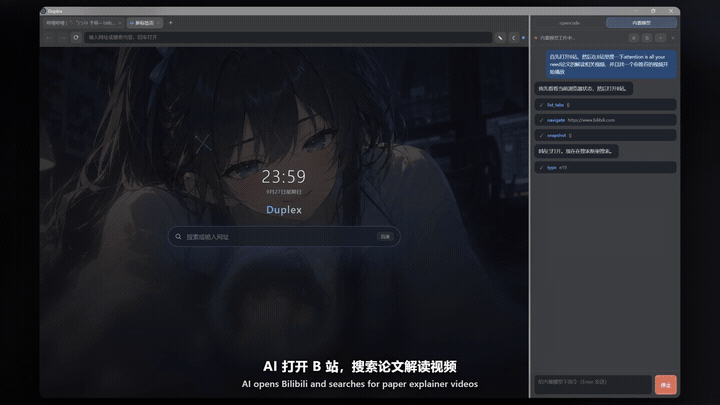

# Duplex

[](https://github.com/Eric-huang799/duplex/actions/workflows/build.yml)
[](https://glama.ai/mcp/servers/Eric-huang799/duplex)
[](https://github.com/punkpeye/awesome-mcp-servers)
[](https://github.com/MobinX/awesome-mcp-list)
[](https://github.com/TensorBlock/awesome-mcp-servers)
[](https://github.com/yzfly/Awesome-MCP-ZH)
[](https://freemcp.space/featured/duplex)

> **已收录于** [awesome-mcp-servers](https://github.com/punkpeye/awesome-mcp-servers) · [awesome-mcp-list](https://github.com/MobinX/awesome-mcp-list) · [TensorBlock](https://github.com/TensorBlock/awesome-mcp-servers) · [Awesome-MCP-ZH](https://github.com/yzfly/Awesome-MCP-ZH) · [freemcp.space](https://freemcp.space/featured/duplex) · [Glama](https://glama.ai/mcp/servers/Eric-huang799/duplex)

<p align="center"></p>

> **一个人和一个 AI 共用的浏览器。** 你看到渲染后的页面；AI 读取 DOM、源码和截图，并能通过浏览器工具操作。同一个标签、同一个实时会话、同一时刻。

[English](README.md) | **中文**


*Duplex 起始页（浅色主题）。另含[深色主题](docs/screenshots/start-page-dark.png)。*

## 演示



*短视频循环：AI 搜索 B 站、打开视频并开始播放，侧栏实时镜像每一步。*

**完整演示 —— 2 分钟，带字幕与音乐：**

[](docs/videos/duplex-demo.mp4)

*一条连续走查：AI 打开世界上第一个网站、播放 B 站视频、通关扫雷、在网页版 Word 里写下一句话，并查看电脑上已有的书签——右侧面板同步展示每一步决策，浏览器画面始终可见。*


*一次更难的、非脚本化测试：没有安装任何表格专用 skill，内置模型只靠原厂 API 和少量简单自动化 skill，把一整张成绩表写进了网页版 Excel。效果是有的，但过程很慢、消耗了大量 token——这是可行性演示，不是推荐用法。*

## 0.2.10：面板驱动的 agent 浏览器控制

0.2.10 把 AI 与浏览器之间的边界说清楚了：**只有当你从 Duplex 面板发起或续接一个 agent 时，它才获得浏览器控制权。** 不会在背后给任何 CLI 安装全局 MCP。

- **中英双语界面** —— 渲染层、原生菜单、右键菜单、对话框与标注浮层均支持简体中文 / English；可跟随系统，也可在工具菜单中固定语言。
- **应用内搜索引擎下拉** —— 地址栏引擎选择改为主题化的应用内下拉，可选百度、Bing、Google，不再依赖系统原生弹出菜单。
- **面板驱动的浏览器控制** —— Codex、Claude Code、opencode 只在从面板发出的提示中获得 Duplex 的 MCP 浏览器工具。独立运行的会话拿不到浏览器控制权。opencode 使用专用 `duplex` agent，普通会话默认拒绝 `duplex_*`。

| Agent | 面板中的对话 | 从面板获得浏览器控制 | 从面板继续会话 |
|---|---|---|---|
| **内置模型** | 实时流 | 内置浏览器工具 | 会话历史 |
| **opencode** | 实时文本 + 工具调用 | `duplex` agent，允许 `duplex_*` | 面板消息或插件 |
| **Codex** | 本地会话记录 | 每次面板启动 / 续接时注入 MCP | `codex exec resume` |
| **Claude Code** | 本地会话记录 | 每次面板启动 / 续接时通过 `--mcp-config` 注入 MCP | `claude --resume` |
| **Gemini / Qwen / 自定义 CLI** | 会话记录 / 流 | 取决于 CLI 自带的工具 | 由 CLI 决定 |

## 为什么需要 Duplex

多数 AI 浏览器工具落在两个极端：

- **独立的自动化实例**运行一个隐藏的浏览器。你看不到页面，用不上同一个登录态，也无法在 AI 即将做错时接管。
- **浏览器旁边的聊天助手**能讨论页面，却无法可靠地操作你正在使用的页面。

Duplex 是一个真正的桌面浏览器，同时为人和 AI 设计。AI 在你看到的同一个标签、同一个登录会话里工作；每一步操作都显示在页面上；当你伸手操作时，AI 会让路，而不是和你抢输入。

它不是给远程 agent 套一层浏览器外壳。它本身就是浏览器。

## 特性一览

- **一个真正的浏览器** —— 多标签、地址栏搜索（百度 / Bing / Google）、前进 / 后退 / 刷新、加载状态、主题、壁纸起始页、可自定义快捷键、完整书签管理与会话恢复。
- **人机协作（以人为先）** —— 每个 AI 任务绑定在自己的标签上。你滚动、输入或聚焦时，AI 继续读取但暂停该页的修改；状态条列出人工接管的页面，点一下即可逐页交还。
- **24 个浏览器工具** —— `snapshot` 把页面压缩成带 `[eN]` ref 的紧凑 DOM 大纲；点击、输入、拖拽与读取走浏览器自身 Chromium 上的 Playwright locator，支持 iframe、开放 shadow DOM 与可取消等待。桥接还向内置 agent 提供 6 个 skill/文件工具。
- **面板驱动的 agent 控制** —— Codex 与 Claude Code 只在面板启动或续接的这一次调用中获得 MCP 服务；opencode 使用专用 `duplex` agent。独立 agent 拿不到浏览器控制权，也不会自行打开 Duplex。
- **内置模型** —— 接入任意 OpenAI 兼容服务商（DeepSeek、Kimi、Qwen、GLM、Ollama 等），可从 opencode 导入配置，让浏览器通过工具与 skills 自己工作。
- **可见的操作** —— 光标环、元素高亮与状态条展示 AI 正在做什么；页面标注允许你画框、圈、箭头或点选并附上问题。
- **急停** —— 随时按 `F2` 或 `Ctrl+Shift+K`（可自定义）。正在执行的工具调用会被中止，CLI 子进程会被终止，待确认操作会被拒绝，排队消息会被清空。挂起状态重启后仍保留。
- **本地优先** —— 设置、历史、书签、标签与会话数据保存在本机；提示只发送给你配置的模型服务商或 CLI。

## 功能展示

### 内置 agent 在真实页面里工作


*内置模型在真实的网页版 Word 会话里工作；每次工具调用以卡片展示，页面始终可见。*

### 外部 agent 在同一个面板里


*Codex 与 Claude Code 的会话镜像在同一个面板中。用工具选择器启动或续接会话，在面板里发言即可继续同一线程。*

### 可见的 AI 操作


*AI 的每一步都画在页面上——光标、元素高亮与状态条。按 F2 即可接管。*

### 页面标注


*画框、圆圈、箭头或点选并附上问题；Duplex 会把它整理成结构化文本交给 AI。*

## 快速开始

### 安装包（Windows / macOS / Linux）

1. 从 [Releases](../../releases) 下载最新安装包：`Duplex Setup x.y.z.exe`（Windows）、`.dmg`（macOS，Apple Silicon / Intel）或 `.AppImage`（Linux）。
2. 安装并启动 Duplex。

### 从源码构建

```bash
npm install
npm run build          # Electron 应用 -> out/
npm run build:bridge   # stdio MCP 桥 -> dist-bridge/index.cjs
```

> 如果 Electron 二进制下载失败（例如镜像较慢），可以重试：
> `$env:ELECTRON_MIRROR="https://npmmirror.com/mirrors/electron/"; node node_modules/electron/install.js`

运行：

```bash
npm run dev    # 开发模式，渲染层 HMR
# 或
npm start      # 预览生产构建
```

> 想在已安装版旁边并行跑开发版？把 `DUPLEX_DATA_DIR` 指到另一个目录，两者就不会共享设置、本地端点或单实例锁。

### 第一次使用

1. 点击工具栏的 **AI** 按钮打开面板。
2. 选择 **内置模型** 并添加 OpenAI 兼容服务商，或在工具选择器中选择一个外部 CLI。
3. 让它做一件看得见的事：*“打开 Hacker News，总结前三条新闻。”*

## 接入 Agent

0.2.10 的核心规则：**独立运行的 agent 会话拿不到 Duplex 的浏览器工具。** 工具只在一次面板驱动的启动或续接中注入。这样默认就是安全的：终端里的 agent 不会悄悄打开浏览器或接管你的会话。

### 内置模型

面板 → **内置模型** → **模型配置**。添加 OpenAI 兼容服务商（base URL、API Key、模型名），或点击 **从 opencode 导入** 复用现有配置。本地模型可通过 Ollama 接入，例如 `http://localhost:11434/v1`。

内置 agent 可以加载 skills、读写项目文件、运行命令；文件和命令操作会使用权限确认卡片。

### opencode

1. 安装镜像插件：把 `integrations/opencode/plugins/cobrowse-mirror.ts` 复制到 `~/.config/opencode/plugins/`，或项目的 `.opencode/plugins/`。
2. 在 `opencode.json`（项目级或全局）中注册 MCP 服务和 `duplex` agent，参考 [`opencode.example.json`](opencode.example.json)。普通会话拒绝 `duplex_*`，只有 `duplex` agent 允许。

```json
{
  "permission": {
    "*": "allow",
    "duplex_*": "deny"
  },
  "agent": {
    "duplex": {
      "mode": "primary",
      "permission": {
        "*": "allow",
        "duplex_*": "allow"
      }
    }
  },
  "mcp": {
    "duplex": {
      "type": "local",
      "command": ["node", "C:\\path\\to\\Duplex\\dist-bridge\\index.cjs"],
      "enabled": true
    }
  }
}
```

3. 在 Duplex 的工具选择器中选择 **opencode**，直接在面板里发送请求。插件会把消息投递给当前 opencode 会话，并切换到 `duplex` agent；只有这轮面板消息获得浏览器控制能力。
4. 如需从 opencode 手动触发，显式选择 `duplex` agent。

### Codex

打开 Duplex 面板，在工具选择器中选择 **Codex**，选择模型并新建会话（或从历史列表打开已有会话）。

- Duplex 只对这一次 `codex exec` / `codex exec resume` 调用，通过 `-c` 参数传入 MCP 服务；不会写入全局 `[mcp_servers.duplex]`。
- Codex 继续使用 Codex CLI 自己的认证与模型配置。
- Codex 会话记录会镜像到面板；在面板里发言会用 `codex exec resume` 续接同一个线程。

### Claude Code

打开 Duplex 面板，选择 **Claude Code**，选择模型并新建或续接会话。

- Duplex 会生成临时 MCP 配置并通过 `--mcp-config` 传入，同时追加浏览器操作指令，只在本次调用中允许 `mcp__duplex` 工具。
- 不会在 Claude Code 的用户配置中留下全局 `duplex` MCP 服务。
- Claude Code 继续使用自己的认证与模型配置；会话记录会镜像到面板，面板回复通过 `claude --resume` 续接。

### Gemini、Qwen 与自定义 CLI

Gemini CLI、Qwen Code 和用户自定义 CLI 可以在同一个面板中列出、启动和镜像。它们**不会**自动获得 Duplex 的 MCP 服务；浏览器能力取决于它们自带的工具。如果某个 CLI 支持 MCP，需要显式指向 `dist-bridge/index.cjs`。

### 显式 MCP 客户端

任何 MCP 客户端都可以直接运行 stdio 桥：

```bash
node C:\path\to\Duplex\dist-bridge\index.cjs
```

桥接会把工具调用代理给正在运行的应用，并在应用未启动时拉起它。每个桥接进程拥有独立的调用方身份。这条路径面向明确需要 MCP 集成的用户，与 Codex / Claude / opencode 的面板驱动流程相互独立。

## MCP 工具

| 工具 | 说明 |
|---|---|
| `list_tabs` / `new_tab` / `close_tab` / `switch_tab` | 标签管理——人与 AI 共用同一批标签 |
| `navigate` / `search` / `history` | 打开网址（非 URL 自动转为搜索）、搜索（默认百度，可选 Bing / Google）、后退 / 前进 / 刷新 |
| `snapshot` | 页面文本化——紧凑 DOM 大纲，可交互元素带 `[eN]` ref |
| `get_html` / `query` | 原始 HTML，或按 CSS 选择器查询元素详情 |
| `screenshot` | 可视区域 PNG 截图（供多模态模型） |
| `click` / `dblclick` / `hover` | 走 Playwright 的单击 / 双击 / 悬停；`target` 支持 `eN` ref 或 CSS 选择器，操作会等待元素可交互 |
| `type` / `press` | 输入文本（可附带回车提交）与按键，支持 `Control+A` 等组合键 |
| `drag` | 从一点 / 元素到另一点的真实拖拽 |
| `select_option` / `upload` | 原生 `<select>` 选项操作与按绝对路径上传文件 |
| `scroll` | 滚动页面或将指定元素滚入视口 |
| `wait` | 等待时间 / 选择器 / 文本——可取消；你正在交互时会带原因让位 |
| `get_console` | 读取页面控制台日志（错误与警告） |
| `annotation_mode` | 进入 / 退出标注模式（人在页面上画框 / 圈 / 箭头 / 点选并提问） |
| `evaluate` | 在页面中执行 JS，返回可 JSON 序列化的结果 |

同一个桥接还向内置 agent 提供 6 个 skill/文件工具：`read_skill`、`list_skill_files`、`read_skill_file`、`run_skill_script`、`write_file`、`run_command`。

## 工作原理


- Electron 主进程在 `127.0.0.1` 上提供本地 HTTP API，使用每次启动生成的 bearer token 鉴权。端点信息写入 `~/.cobrowse/endpoint.json`（或 `$DUPLEX_DATA_DIR/endpoint.json`）。
- `dist-bridge/index.cjs` 是 stdio MCP 服务，把工具调用代理到该 API，并在应用未运行时拉起应用。显式 MCP 客户端和面板驱动的 agent 使用的是同一个桥接。
- 页面自动化是**跑在浏览器自身 Chromium 上的 Playwright**：应用读取 `DevToolsActivePort`、按 `targetId` 对应到每个标签，驱动 locator、iframe、开放 shadow DOM、可取消等待与脚本执行——操作的就是你眼前这个页面，而不是另一个自动化实例。
- **协作层**把每个任务绑定到它的标签，对同页写操作串行化，监听真实的人工输入（滚轮 / 触摸 / 键盘 / 焦点），并逐页暂停 AI 修改；状态条反映这些状态，并提供逐页一键交还。
- **按会话注入**：Codex 通过 `-c mcp_servers.duplex...` 获得 MCP 服务；Claude Code 通过临时配置和 `--mcp-config` 获得。两者都不会被写入全局配置。
- **opencode 插件**把会话事件推入面板，并长轮询取走排队消息。面板来源的提示使用专用 `duplex` agent，普通会话继续拒绝 `duplex_*`。投递单次领取（60 秒租期、自动续租、ACK 确认），且面向绑定的会话。
- **Codex 与 Claude Code** 的对话从本地会话记录实时尾随镜像（历史 + 增量）；面板回复会续接同一线程，新回合经同一尾随通道流回面板。启动对象按结构化会话 ID 匹配，而不是“最近被修改的文件”。
- 浏览器状态（标签顺序、HTTP(S) URL、活动页）在退出时保存、下次启动时恢复。外部脚本也可以通过 `POST /api/chat { "text": "..." }` 注入消息。

## 安全与隐私

Duplex 让 AI 接触你**真实的浏览器会话**，包括登录态、Cookie 与本地数据。请把它当作高风险能力。

- **控制权始终在你手里。** 你操作页面时 AI 会让路；急停会切断 AI 操作、CLI 子进程和排队消息。内置 agent 的写文件、运行命令等工具调用需要确认。
- **本地优先。** 设置、浏览器数据、历史、书签与会话保存在本机。提示与页面内容只发送给你配置的模型服务商或 CLI；Duplex 不经过云端中转。
- **显式导入。** 从 opencode 或 Codex 导入的凭据是只读副本；导入的 OAuth 凭据只允许发往官方域名。
- **面板驱动的 agent。** Codex 与 Claude Code 没有全局 MCP 条目；opencode 在 `duplex` agent 之外拒绝 `duplex_*`。终端里的 agent 无法悄悄打开 Duplex。
- **数据目录。** 默认全部位于 `~/.cobrowse`；可用 `DUPLEX_DATA_DIR` 隔离开发版、测试或多套配置。

## 与其他项目的区别

| | **Duplex** | browser-use | Browser MCP | Playwright MCP | AI 浏览器（Atlas / Comet） |
|---|---|---|---|---|---|
| 形态 | 桌面浏览器（Electron 应用） | Python 自动化框架 | MCP 服务（浏览器扩展） | MCP 服务（微软官方） | 闭源产品 |
| 谁在使用浏览器 | **人与 AI 共用同一个标签、同一个实时会话** | AI 独占的独立自动化实例 | AI 驱动你当前的 Chrome | AI 独占的 Playwright 实例 | AI 助手在旁辅助 / 操作 |
| AI 的感知 | DOM 大纲快照 + 源码 + 截图 | 视觉 + DOM | 截图 + 可访问性树 | 可访问性树 | 内部实现 |
| 人机协作 | **同屏实时协作；急停键可随时打断 AI** | 事后看日志 | 人旁观 | 人旁观 | 有限人工干预 |
| 两边同时操作同一页时 | **AI 给人让路：逐页暂停 + 一键交还** | — | — | — | — |
| 可接入的 AI | **内置模型 + 面板驱动的 opencode / Codex / Claude Code；镜像 Gemini / Qwen；显式 MCP 客户端** | 自带 LLM | 任意 MCP 客户端 | 任意 MCP 客户端 | 仅官方模型 |
| AI 对话可见性 | **侧边面板实时镜像：opencode 文本与工具调用；Codex / Claude Code 会话记录** | 日志/终端 | 客户端内 | 客户端内 | 应用内 |
| 数据 | 本地优先 | 本地/云端 | 本地 | 本地 | 云端 |

> 一句话：browser-use / Playwright MCP 解决的是“让 AI **替你跑**流程”；Duplex 解决的是“让 AI **和你一起用**你正开着的那一个浏览器”——同一个标签、同一个会话；当你们同时伸手碰页面时，**你先**。

## 已知限制

- 主要操作走 Playwright/CDP，但部分回退路径会使用合成 DOM 事件（例如可交互性检查失败时的 `el.click()`）。依赖完全可信输入、`contenteditable` 或自定义控件的站点需要人工协调；已经发生的副作用无法撤销。
- 取消粒度：在途 Playwright 调用以 200–250 ms 轮询为界。已经完成的点击、提交或写入不能回滚。
- `evaluate` 会清理其作用域内的计时器 / RAF / fetch，但无法撤销通过 `document.defaultView` 等途径注册的外部回调；该高级能力的使用范围还在进一步收紧。
- 元素 ref 与快照绑定：导航或 DOM 大改后请重新 `snapshot`（过期 ref 会明确报错，而不是点错元素）。
- Codex / Claude Code 的会话从本地记录镜像，格式由这些 CLI 控制。启动身份不明确时会拒绝，而不是猜测。
- Gemini、Qwen 与自定义 CLI 可以镜像和启动，但不会自动获得 Duplex 的 MCP 工具。
- opencode 的消息去重依赖插件；若其断网超过租期，已接受但未确认的消息可能重复投递。精确去重需要上游提供消息 ID。
- 直接使用 MCP 的客户端各自拥有按进程生成的调用方身份；明确的任务开始 / 结束 / 交接协议计划在 0.3.0 提供。
- 内置多模态图片上下文、站点特殊控件与跨平台交互验收尚未完全覆盖。Windows 是主要目标；macOS / Linux 构建可用但测试较少。
- 内置模型是便捷选项：本地或小模型在长工具链任务上的可靠性明显低于完整的 opencode 方案。

## 路线图

- **v0.3.0 —— 协作继续深化**
  - 为 MCP 调用方提供明确的任务生命周期 / 交接协议（开始、结束、恢复），并把动作拆成粒度更细的可取消步骤。
  - `contenteditable` 与自定义控件的回退方案；更完整的 CLI 会话生命周期；多模态验收。
  - 社区 backlog：命令面板、标签搜索、阅读模式、书签 HTML 导入 / 导出等（维护中的清单见 `docs/待办与用户反馈.md`）。

## 开发

```bash
npm run dev        # 开发模式（electron-vite，渲染层 HMR）
npm run typecheck  # TypeScript 检查（node + web）
npm test           # 单元测试（vitest，340+ 用例）
npm run smoke      # 端到端冒烟测试（拉起桥接与真实浏览器）
npm run dist       # 构建 Windows 安装包（electron-builder）
```

自包含冒烟测试（隐藏的 Electron + 临时数据目录，不碰你自己的会话）：

```bash
node tests/playwright-connection-smoke.mjs   # Playwright 层对隐藏夹具浏览器
node tests/private-029-smoke.mjs             # 主进程协作场景
```

调试辅助：

- `GET /api/debug/ui-snapshot` —— 截取当前窗口到 `~/.cobrowse/ui-snapshot.png`。
- `POST /api/debug/panel-eval` —— 在面板渲染层执行 JS（仅当应用以 `COBROWSE_DEBUG_UI=1` 启动）。
- `POST /api/debug/ui-action` —— 驱动面板动作（测试使用，例如 `{"action":"panel-mode:opencode"}`）。
- 日志：`~/.cobrowse/app.log`。

## 常见问题

**Duplex 能替代我日常使用的浏览器吗？** 它是一个独立浏览器，定位是你和 AI 共用的浏览器。它不会加载你的 Chrome 配置文件或 Chrome 扩展。

**能用 ChatGPT 或 Claude 订阅吗？** 内置模型使用 OpenAI 兼容 API 和你的 API Key。Codex 与 Claude Code 使用各自的 CLI 和认证；Duplex 不会复用 ChatGPT 网页会话。

**agent 会自动打开 Duplex 吗？** 不会。独立运行的 Codex、Claude Code 与 opencode 会话拿不到 Duplex 的 MCP 工具。只有在面板里启动、续接或发送 opencode 消息时才会启用浏览器控制。

**可以在已安装版旁边跑开发版吗？** 可以。把 `DUPLEX_DATA_DIR` 指向另一个目录，两者不会共享设置、端点或单实例锁。

**数据在哪里？** 默认在 `~/.cobrowse`：设置、浏览器数据、会话、skills 与日志。可用 `DUPLEX_DATA_DIR` 改到其他位置。

## 关于作者

我不是职业开发者——只是一个对 AI 好奇的普通电脑用户。Duplex 是我利用业余时间一点点做出来的爱好项目，一边做一边学（也借助了 AI 编程工具）。

它还很粗糙：有我尚未发现的 bug，有会惹恼你的设计，也有我根本没注意到的毛边。如果你愿意试一试，任何反馈对我都很重要：一个 bug、一次崩溃、一个令人困惑的步骤，或者仅仅是一句“它在我这里没启动”——都欢迎开 [Issue](https://github.com/Eric-huang799/duplex/issues)。中英文都可以。

谢谢你读到这里，也谢谢你愿意试一下。

## 许可证

[MIT](LICENSE)
